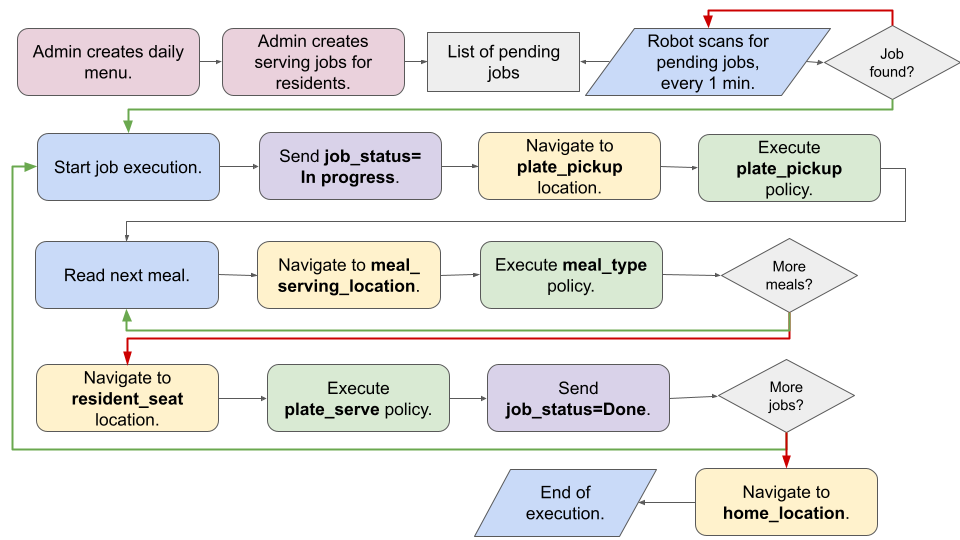

# Meal Service — Jetson App

Robot-side Python app implementing the Serving Job flow from the Summer Robotics Challenge 2026 spec. Runs on the Jetson Orin Nano, polls a cloud admin panel for pending jobs, and executes them: pick up a plate, portion each meal, serve it to the resident.



## What it does

1. Polls the admin panel every `POLL_INTERVAL_SECONDS` (default 60s, per spec) for a pending Serving Job.
2. When a job is found:
   - Marks it `in_progress`. If a meal's `meal_type` has no trained policy (`policy_path: null`), marks it `failed` without moving
   - Place B (kitchen): navigates to the plate pickup location, runs `plate_pickup` (skipped while it has no `policy_path`), then for each meal the policy matching its `meal_type`
   - Place C (table): navigates to `job.seat_id`, runs each meal's `serve_policy` (e.g. `plate_serve_right` for a product picked with the right arm)
   - Marks the job `done`

   Every policy is one `lerobot-rollout` run. It blocks until the arm is back at rest and its port is released, so the robot is parked for the whole policy — one policy at a time, never while driving.
3. If another job is pending immediately after, starts it right away without returning home first.
4. Once the queue is empty, navigates to `home_location` and resumes polling.
5. If no job has been found for `NO_JOB_TIMEOUT_SECONDS` (default 5 minutes), the app logs it and exits — it does not poll forever.

## File structure

| File | Responsibility |
|---|---|
| `main.py` | Entry point only — sets up logging, loads config files, hands off to `job_service.run_service()`. No logic lives here. |
| `job_service.py` | The actual behavior: `execute_job()` (one job end to end) and `run_service()` (the poll/execute/chain loop, including the no-job timeout). |
| `navigation.py` | Loads `locations.yml` / `routes.yml`, exposes `navigate_to(location_id)`: tracks the robot's zone and runs the route scripts (`route_part1/2/3.py`) that lead to the target zone. |
| `policies.py` | Loads `policies.yml` + `rollout.yml`, exposes `execute_policy(policy_id)`. Builds the `lerobot-rollout` command for the policy's arm (port, robot id, cameras, fps) and runs it. Prints each command as a copy-pasteable line and checks paths/ports/cameras/calibration files at launch. |
| `hw_process.py` | Runs one hardware-owning child process (route script or rollout): live output, timeout, a clean stop with one SIGINT, and the `HARDWARE_SETTLE_SECONDS` gap before any motor bus is reopened. |
| `test_script.py` | Runs one policy exactly as the service would (no admin panel, no driving): `python test_script.py dessert_banana [--dry-run]`. |
| `robot_connection.py`, `policy_common.py`, `policy_loaders/`, `robot.yml` | **Unused** since policies run through `lerobot-rollout` (old in-process inference). Safe to delete. |
| `api_client.py` | All HTTP calls to the cloud admin panel: `get_pending_job()`, `set_job_status()`. |
| `event_logger.py` | Central logging setup and `log_event()`, used by every module above so all events land in one consistent format. |
| `config.py` | All configuration in one place — API URL/key, poll interval, timeout, file paths. |
| `policies.yml` | One entry per policy. Products use the admin panel's `meal_type` as `policy_id`, each with its own `policy_path` (`.../checkpoints/<step>/pretrained_model`), `arm`, `task_instruction`, `execution_seconds` and `serve_policy`. |
| `rollout.yml` | Everything that changes between boots: each arm's port, `robot.id`, which camera feeds `top`/`wrist`; camera devices; fps; rollout strategy. |
| `locations.yml` | Maps each `location_id` (home, plate pickup, meal serving slots, resident seats) to its physical coordinates. |

Navigation and policy execution are isolated in their own files specifically so a stub can be swapped for a real implementation later without touching `job_service.py` or `main.py` — the function signatures (`navigate_to(location_id, locations)`, `execute_policy(policy_id, policies)`) stay the same either way. This held for both the switch to real route-script driving and the switch to `lerobot-rollout` policies.

## API

Robot-facing endpoints on the admin panel, both authenticated via `Authorization: Bearer <API_KEY>`:

- `GET /api/public/robot/jobs/pending` — returns either the next pending job as a direct object (`{"job_id": ..., "seat_id": ..., "meals": [...]}`), or `{"job": null}` when the queue is empty.
- `PATCH /api/public/robot/jobs/{id}` — body `{"status": "in_progress"}` or `{"status": "done"}`.

## Running it

```bash
python main.py
python main.py --port right=/dev/ttyACM0 --port left=/dev/ttyACM1 --cam head=/dev/video8
```

`--port ARM=DEVICE` / `--cam CAMERA=DEVICE` override `rollout.yml` for this run (names as in `rollout.yml`).

Check a single policy at its stop first:

```bash
python test_script.py dessert_banana --dry-run   # print the command only
python test_script.py dessert_banana             # run it on the arm
```

## Dummy running

To run for testing without navigation or without policy execution, execute with one of the two arguments:

* `--no-policies`
* `--no-navigation`

```bash
python main.py --no-policies
```

```bash
python main.py --no-navigation
```

Or with both, to just test the app flow:

```bash
python main.py --no-policies --no-navigation
```

`--policy-dry-run` drives the real routes and stops at each place, but only prints each `lerobot-rollout` command instead of running it:

```bash
python main.py --policy-dry-run
```

## Required libraries

```bash
pip install pyyaml requests
```

Policies run with the `lerobot060` env's `lerobot-rollout`, pinned in `rollout.yml` (`rollout_bin: /home/jetson8/miniconda3/envs/lerobot060/bin/lerobot-rollout`) — the same as `conda activate lerobot060; lerobot-rollout`, whichever env `main.py` itself runs in. At launch the app prints the binary and its lerobot version and refuses to start if it isn't lerobot 0.6.

Tested on Python 3.11 (uses no syntax newer than 3.10).

## Configuration

Edit `config.py` before running:

- `API_BASE_URL`, `API_KEY` — cloud admin panel connection
- `POLL_INTERVAL_SECONDS` — how often to check for pending jobs (default 60)
- `NO_JOB_TIMEOUT_SECONDS` — how long to keep polling with no jobs found before exiting (default 300, i.e. 5 minutes)
- `POLICIES_FILE`, `LOCATIONS_FILE`, `ROUTES_FILE`, `ROLLOUT_FILE` — paths to the config files
- `HARDWARE_SETTLE_SECONDS` — gap between one route/policy process releasing the motor buses and the next opening them (default 3)
- `POLICY_TIMEOUT_MARGIN_SECONDS`, `POLICY_SIGINT_GRACE_SECONDS` — rollout watchdog: allowed on top of `execution_seconds`, and time to shut down cleanly after being stopped
- `LOG_DIR` — directory for log files (default `logs/`)

Edit `policies.yml` (checkpoint per product), `rollout.yml` (ports/cameras), `locations.yml` and `routes.yml` before running against real hardware.

## Logging

Every run creates its own timestamped log file under `logs/` (e.g. `logs/meal_service_2026-07-14_13-42-05.log`), so separate executions never overwrite each other. Every module logs through `event_logger.log_event()`, producing consistent lines like:

```
2026-07-14 13:42:05 [INFO] navigate_start | location_id=plate_pickup coordinates={'x': 0.0, 'y': 0.0, 'theta': 0.0}
2026-07-14 13:42:07 [INFO] navigate_complete | location_id=plate_pickup
2026-07-14 13:42:10 [INFO] hardware_settle_wait | before=policy:dessert_banana seconds=3.0
2026-07-14 13:42:10 [INFO] policy_start | policy_id=dessert_banana arm=right port=/dev/ttyACM0 execution_seconds=60 dry_run=False
2026-07-14 13:43:31 [INFO] policy_complete | policy_id=dessert_banana output_log=logs/rollout_dessert_banana_2026-07-14_13-42-10.log
2026-07-14 13:42:07 [INFO] no_job_found | elapsed_since_last_job_seconds=0
2026-07-14 13:47:07 [INFO] no_jobs_timeout_exit | elapsed_seconds=300
```

Logs go to both the file and stdout, so `python main.py` is watchable live during testing as well as reviewable afterward. Each rollout's full output is also saved to `logs/rollout_<policy_id>_<time>.log`; with `strategy: episodic` its recorded episode lands in `dataset_root_dir/<policy_id>_<time>`.

## What's real vs. skipped right now

- **Real**: job polling, status updates, config loading, job sequencing/chaining, no-job timeout, logging, route-script navigation between zones, policy execution via `lerobot-rollout` for every entry with a `policy_path`.
- **Skipped**: `plate_pickup` / serve steps whose `policy_path` is `null`. A product (`meal_type`) with `policy_path: null` fails its job before the robot moves.

## Not yet implemented

- QR-code meal verification (explicitly deferred, per spec)
- Retry/escalation after a failed step: a failed route stops the service; a failed policy fails the job and the robot carries on to the next job / home
- Obstacle detection during navigation
- Two arms at once at one stop (each stop runs its policies one at a time, single-arm `so101_follower`)
